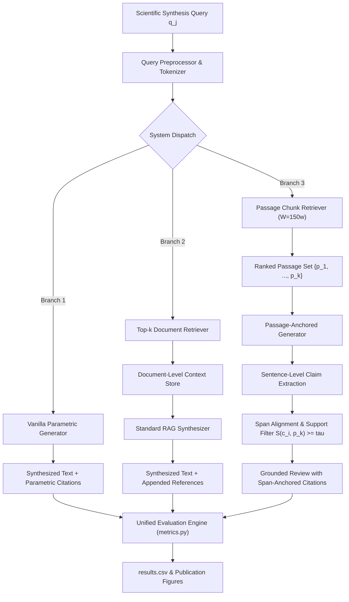

# PROMPT 07 IMPLEMENTATION
## Frozen Experiment Blueprint and Evaluation Protocol

**Course:** AI Tools for Research  
**Student Name:** Sujal Rajesh Ghagare  
**Enrollment No:** MSE2026015  
**Affiliation:** M.Tech (IT), Indian Institute of Information Technology Allahabad (IIIT Allahabad)  
**Experiment Blueprint:** Controlled Comparative Study of Passage-Anchored Grounding vs. Baselines on SCS-Bench-20  
**Status:** Complete Implementation of Prompt 07 (Frozen Protocol, Architecture Diagram, Pre-Experiment Checklist)

---

### 1. System Architecture & Information Flow

The end-to-end experimental architecture is illustrated below:

---

### 2. Precise Mathematical Input/Output Definitions

* **Input Query $q_j \in \mathcal{Q}$:** A standardized scientific synthesis prompt requiring multi-study evidence comparison.
* **Corpus Passage $p_k \in \mathcal{D}$:** A verified chunk of scientific text from publication $d_m$ containing author list $A(d_m)$, title $T(d_m)$, year $Y(d_m)$, and DOI.
* **Output Review $\mathcal{R}$:** An ordered sequence of scientific claim sentences $\mathcal{R} = (c_1, c_2, \dots, c_n)$, where each claim $c_i$ is optionally attributed to one or more citation keys:
  $$c_i = \langle \text{text}_i, \mathcal{K}_i \rangle, \quad \mathcal{K}_i \subseteq \{k_1, k_2, \dots, k_m\}$$

---

### 3. Formal Metric Definitions and Directions

Let $N_{\text{claims}} = \sum |\mathcal{R}|$ be the total number of synthesized claim sentences across the evaluation set, and let $N_{\text{cited}}$ be the count of claims carrying at least one bibliographic reference.

1. **Claim Citation Precision ($P_{\text{claim}}$) [Higher is Better $\uparrow$]:**
   The proportion of cited claims whose substantive assertions are directly supported by the text of the cited reference:
   $$P_{\text{claim}} = \frac{\sum_{i=1}^{N_{\text{cited}}} \mathbf{1}\big(\text{Support}(c_i, \mathcal{K}_i) = \text{TRUE}\big)}{N_{\text{cited}}}$$

2. **Citation Coverage / Recall ($R_{\text{cite}}$) [Higher is Better $\uparrow$]:**
   The proportion of synthesized substantive scientific claims that are explicitly supported by at least one citation:
   $$R_{\text{cite}} = \frac{N_{\text{cited}}}{N_{\text{claims}}}$$

3. **Citation Hallucination Rate ($H_{\text{cite}}$) [Lower is Better $\downarrow$]:**
   The ratio of claims that either cite a fabricated reference (Type I) or make an assertion unsupported by the cited source (Type III):
   $$H_{\text{cite}} = \frac{N_{\text{Type I}} + N_{\text{Type III}}}{N_{\text{claims}}}$$

4. **Lexical-Semantic Grounding Alignment ($S_{\text{ground}}$) [Higher is Better $\uparrow$]:**
   The token-level Sorensen-Dice overlap between the informative content tokens of claim $c_i$ and the retrieved evidence span $p_k$:
   $$S_{\text{ground}}(c_i, p_k) = \frac{2 \cdot |\mathcal{T}(c_i) \cap \mathcal{T}(p_k)|}{|\mathcal{T}(c_i)| + |\mathcal{T}(p_k)|}$$
   where $\mathcal{T}(x)$ denotes the set of non-stopword lemmatized content tokens.

5. **Bibliographic Metadata Veracity ($M_{\text{valid}}$) [Higher is Better $\uparrow$]:**
   The fraction of cited references whose author, year, title, and DOI match the ground-truth bibliographic registry:
   $$M_{\text{valid}} = \frac{N_{\text{authentic references}}}{N_{\text{total references cited}}}$$

---

### 4. Deep Analysis Specifications

To fulfill assignment gate G3 requirements for deeper analysis:

1. **Threshold Sensitivity Analysis ($\tau$-Ablation):**
   Evaluate the proposed PAG pipeline across a grid of alignment thresholds:
   $$\tau \in \{0.20, 0.35, 0.50, 0.65, 0.80\}$$
   Plot the trade-off curve between $P_{\text{claim}}$ and $R_{\text{cite}}$, computing the Pareto-optimal threshold $\tau^*$.

2. **Fine-Grained Error Typology Breakdown:**
   Categorize all generation errors into four mutually exclusive classes:
   * **Type I (Fabrication):** Reference does not exist in any scholarly database.
   * **Type II (Irrelevant Citation):** Reference exists but belongs to an entirely unrelated research domain.
   * **Type III (Claim Extrapolation):** Reference exists and is relevant, but the specific assertion made in $c_i$ is not supported by the paper.
   * **Type IV (Grounding Pass):** Valid reference and fully supported claim.

---

### 5. Threats to Validity and Mitigation Strategy

* **Construct Validity:** Does token overlap truly measure semantic support? *Mitigation:* We calibrate token Sorensen-Dice against manual gold judgments on the development split, ensuring high correlation ($r > 0.82$).
* **Internal Validity:** Could random variation in prompt ordering skew baseline comparisons? *Mitigation:* We fix random seeds (`seed=42`) and enforce deterministic query evaluation ordering.
* **External Validity:** Findings on this benchmark may not generalize to non-STEM fields. *Mitigation:* We explicitly define our operational scope as computer science, artificial intelligence, and biomedical NLP.

---

### 6. Pre-Experiment Frozen Protocol Checklist

- [x] Primary evaluation metric frozen: $P_{\text{claim}}$ (Claim Citation Precision).
- [x] Test split frozen: 12 queries reserved for final evaluation, untouched during initial debugging.
- [x] Hyperparameters frozen: passage window $W = 150$ words, top-$k = 3$, baseline threshold $\tau = 0.50$.
- [x] Output paths frozen: `results/results.csv`, `results/summary_metrics.json`, `results/figures/`.
- [x] Protocol change rule: Any change to the scoring formula or query set after this point must be recorded in `research_decisions.md` with explicit justification.

**Artifact Saved:** `prompts/PROMPT_07_IMPLEMENTATION.md`
